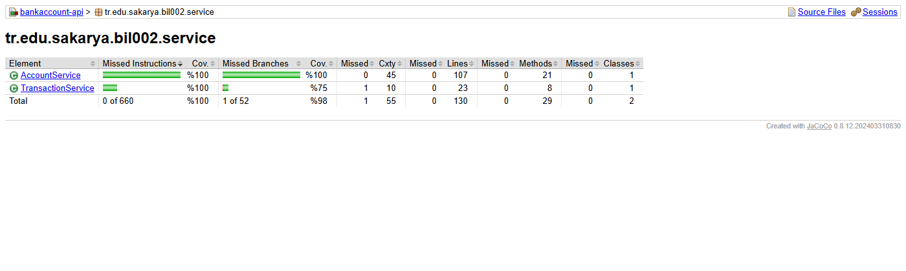
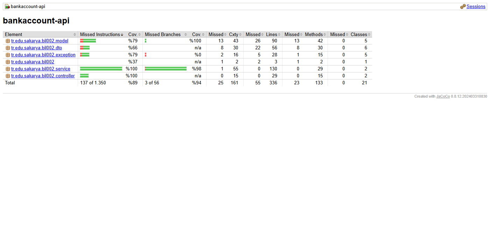
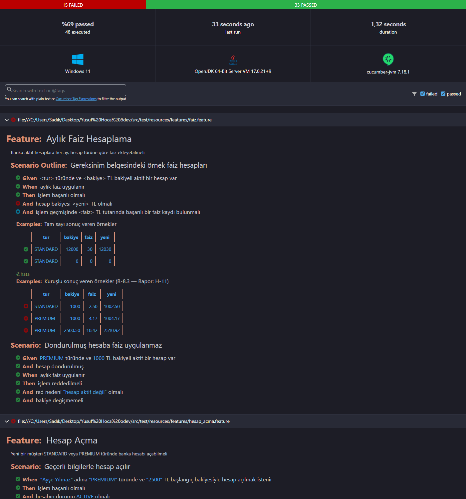
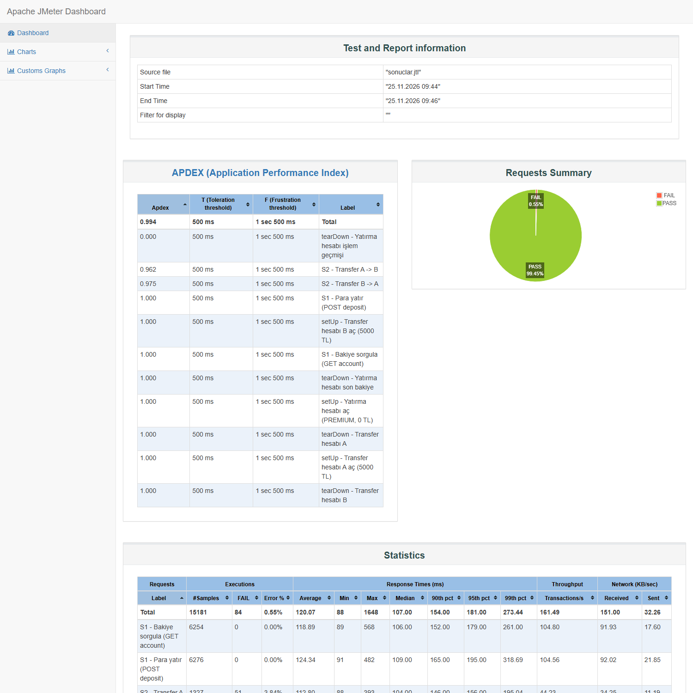
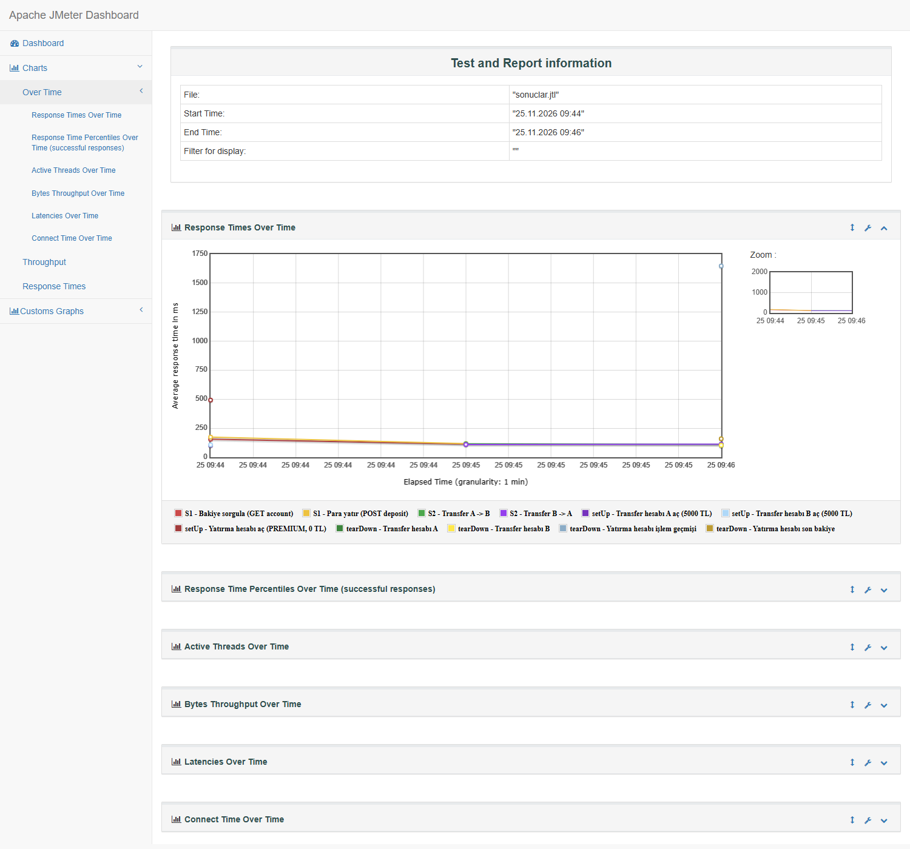
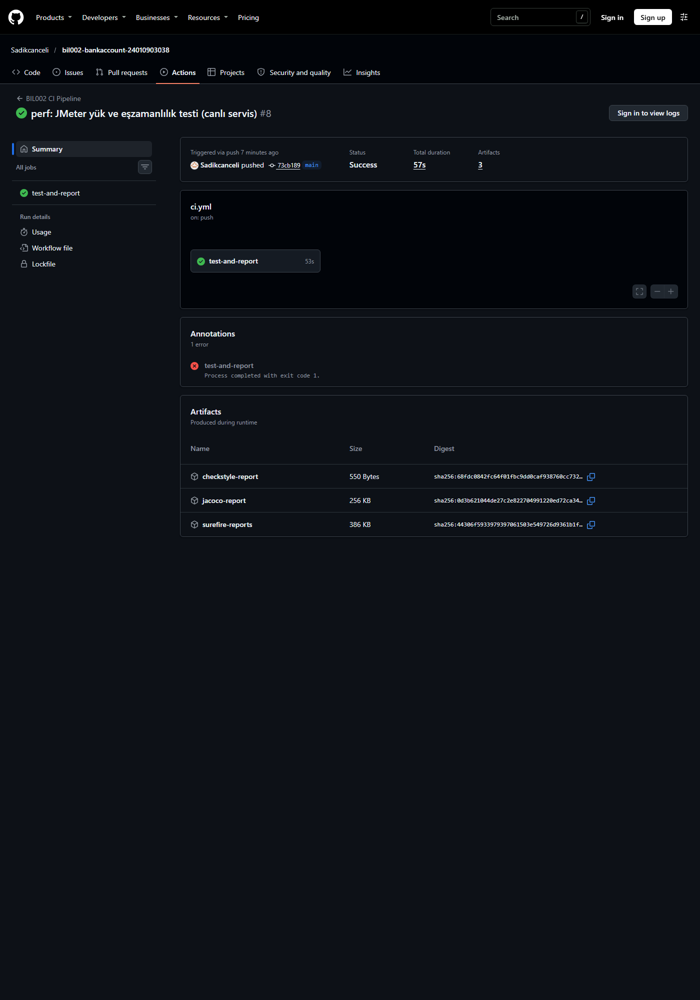

# BIL 002 Dönem Projesi Test Raporu

| | |
|---|---|
| **Öğrenci Adı** | _(doldurulacak)_ |
| **Öğrenci No** | 24010903038 |
| **Tarih** | 26.11.2026 |
| **Kısım 1 Repo URL (BankAccount)** | https://github.com/Sadikcanceli/bil002-bankaccount-24010903038 |
| **Kısım 2 Repo URL (Selenium + Cucumber)** | _(Kısım 2 bölümüne bakınız)_ |

> Bu rapor BYS üzerinden teslim edilir (son tarih: **18 Aralık 2026 Cuma**). Bölüm 1–10 Kısım 1'i,
> en sondaki **Kısım 2** başlığı Selenium/Cucumber çalışmasını kapsar.

**Özet:** Gereksinimler belgesine aykırı **16 hata** bulundu (4 Kritik, 6 Yüksek, 5 Orta, 1 Düşük).
Toplam **178 otomatik test** yazıldı; bunların **46'sı** kasıtlı bir hatayı yakalayıp kırmızı olan ve
`@Tag("hata")` / `@hata` ile etiketlenen testlerdir. `service` paketinde dal kapsamı **%98,1**'dir. İki
kritik hata (H-15, H-16) **yalnızca canlı servise yapılan eşzamanlı yük testinde** ortaya çıkmıştır.

| Test türü | Konum | Test sayısı | `hata` etiketli (kırmızı) |
|---|---|---:|---:|
| Kara kutu (EP, BVA, karar tablosu, durum geçişi) | `src/test/java/.../blackbox/` | 56 | 18 |
| Beyaz kutu | `src/test/java/.../whitebox/` | 26 | 4 |
| Entegrasyon / API (MockMvc) | `src/test/java/.../integration/` | 44 | 9 |
| BDD / Cucumber (senaryo) | `src/test/resources/features/` | 48 | 15 |
| TDD (yeni özellik) | `src/test/java/.../tdd/` | 4 | 0 |
| **Toplam (JUnit + Cucumber)** | | **178** | **46** |
| Postman (canlı servis, newman) | `docs/postman/` | 38 istek / 56 doğrulama | 10 başarısız doğrulama |
| JMeter (canlı servis) | `performans/` | 2 senaryo, 15.181 istek | 2 tutarlılık hatası |

---

# KISIM 1 — BankAccount API Testleri

## 1. Statik Test Sonuçları

Araçlar: **Checkstyle** (projenin `checkstyle.xml` kuralları, CI'daki zorunlu adım), **PMD 7** ve
**SpotBugs 4.8** (pom'a eklenmeden komut satırından çalıştırıldı) ve **elle kod incelemesi**.

```
mvn checkstyle:check
mvn org.apache.maven.plugins:maven-pmd-plugin:3.25.0:pmd
mvn compile com.github.spotbugs:spotbugs-maven-plugin:4.8.6.4:spotbugs -Dspotbugs.effort=Max -Dspotbugs.threshold=Low
```

| # | Araç | Dosya:Satır | Kural / Bulgu | Önem | Yorum |
|---|---|---|---|---|---|
| 1 | Checkstyle | — | 0 ihlal | — | Kod stili kurallara uygun; stil kontrolü mantık hatalarını bulmaz. |
| 2 | PMD | `AccountService.java:193` | `UnusedFormalParameter`: `validateTransferParties(source, target)` metodunda `target` parametresi hiç kullanılmıyor | Yüksek | Hedef hesabın durumu kontrol edilmiyor demektir → **H-07** (R-4.3). Statik analizin doğrudan bir iş kuralı hatasına işaret ettiği bulgu. |
| 3 | SpotBugs | `AccountService.java:171` | `ICAST_IDIV_CAST_TO_DOUBLE`: tam sayı bölmesinin sonucu `double`'a atanıyor | Yüksek | `longValue() * annualRate / 100 / 12` tam sayı aritmetiği → kuruşlar kayboluyor → **H-11** (R-8.3). |
| 4 | Kod incelemesi | `AccountService.java:79` | `amount < 0` koşulu 0'ı kabul ediyor | Orta | R-2.2 `amount <= 0` reddedilir der → **H-02** |
| 5 | Kod incelemesi | `AccountService.java:200` | `amount >= balance` koşulu tam bakiyeyi reddediyor | Orta | R-3.4 → **H-04** |
| 6 | Kod incelemesi | `AccountService.java:216` | PREMIUM için `total >= limit` (STANDARD'da `>`) | Orta | Kapsayıcı limit kuralı → **H-05** |
| 7 | Kod incelemesi | `TransactionService.java:64` | Günlük toplam tarih filtresi olmadan hesaplanıyor | Yüksek | G-6 / Bölüm 3 → **H-06** |
| 8 | Kod incelemesi | `AccountService.java:155` | `closeAccount` bakiye kontrolü yapmıyor | Kritik | R-7.2 → **H-10** |
| 9 | Kod incelemesi | `AccountService.java:45` | `createAccount` negatif `initialBalance` kontrolü yok | Yüksek | R-1.4 → **H-01** |
| 10 | Kod incelemesi | `AccountService.java:226` | Rastgele numara üretiliyor, çakışma kontrolü ve `unique` kısıtı yok | Yüksek | R-1.5 → **H-14** |
| 11 | Kod incelemesi | `AccountService.java` (tümü) | Hesap satırı için kilit (`@Version` / `PESSIMISTIC_WRITE`) yok; oku-değiştir-yaz deseni | Kritik | Eşzamanlılıkta kayıp güncelleme riski → **H-15, H-16** (yük testiyle kanıtlandı) |
| 12 | Kod incelemesi | `AccountController.java:54` | `orElse(ResponseEntity.ok(null))` | Orta | R-10.2 404 ister → **H-13** |
| 13 | Kod incelemesi | `AccountService.java:93-106` | `withdraw` içinde `requireActive` çağrısı yok | Yüksek | R-3.3 → **H-03** |
| 14 | Kod incelemesi | `model/Account.java` | Para tutarı `Double` ile tutuluyor | Düşük | Kayan nokta yuvarlama riski (G-1 kuruş hassasiyeti). Testlerde G-2 toleransı (0,001) kullanıldı; ayrı hata olarak sayılmadı. |

**Gözlem (hata olarak sayılmadı):** Canlı serviste `/h2-console` herkese açık (HTTP 200). Bu bir güvenlik
riskidir ancak Gereksinimler belgesinde buna dair bir kural bulunmadığı için ödev kurallarına göre bulgu
olarak raporlanmamıştır.

---

## 2. Kara Kutu Test Vakaları

Dosya: [`AccountServiceBlackBoxTest.java`](../src/test/java/tr/edu/sakarya/bil002/blackbox/AccountServiceBlackBoxTest.java)
— testler yalnızca Gereksinimler belgesinden türetildi. Her testin `@DisplayName` değerindeki kimlik aşağıdaki
tablolarla eşleşir. **Sonuç** sütunu: ✔ uygulama gereksinime uydu, ✘ hata bulundu (test `@Tag("hata")`).

### 2.1 Denklik Sınıfı Tablosu

| Denklik sınıfı | Geçerli | Geçersiz |
|---|---|---|
| deposit `amount` | 0 < amount ≤ tür limiti | amount ≤ 0, amount > limit, null |
| withdraw `amount` | 0 < amount ≤ bakiye ve günlük limit içinde | amount ≤ 0, amount > bakiye, limit aşımı |
| hesap türü | `STANDARD`, `PREMIUM` | küçük harf, bilinmeyen değer, null |
| hesap durumu (para hareketi) | ACTIVE | FROZEN, CLOSED |
| `ownerName` | dolu metin | null, "", yalnızca boşluk |
| `initialBalance` | null (→0), ≥ 0 | < 0 |

| Test ID | Test metodu | Giriş | Beklenen | Gerçekleşen | Sonuç |
|---|---|---|---|---|---|
| EP-01 | `deposit_gecerliMiktar_basarili` | ACTIVE, 1000 TL + 500 | bakiye 1500, DEPOSIT/SUCCESS | bakiye 1500, kayıt var | ✔ |
| EP-02 | `deposit_sifirMiktar_reddedilmeli` | amount = 0 | reddedilir (400) | kabul edildi | ✘ H-02 |
| EP-03 | `deposit_negatifMiktar_reddedilmeli` | amount = -100 | reddedilir, bakiye aynı | reddedildi | ✔ |
| EP-04 | `deposit_dondurulmusHesap_reddedilmeli` | FROZEN hesaba 100 | reddedilir (409) | reddedildi | ✔ |
| EP-05 | `deposit_kapaliHesap_reddedilmeli` | CLOSED hesaba 100 | reddedilir (409) | reddedildi | ✔ |
| EP-06 | `deposit_olmayanHesap_bulunamadi` | olmayan hesap | hesap bulunamadı | AccountNotFound | ✔ |
| EP-07 | `createAccount_gecersizAd_reddedilmeli` | null / "" / "   " | reddedilir | reddedildi | ✔ |
| EP-08 | `createAccount_gecersizTur_reddedilmeli` | "standard", "GOLD", null | reddedilir | reddedildi | ✔ |
| EP-09 | `createAccount_gecerliPremium_basarili` | PREMIUM, 2000 | ACTIVE, 10 haneli no, kayıt yok | uygun | ✔ |
| EP-10 | `createAccount_nullBakiye_sifirKabulEdilir` | initialBalance null | bakiye 0.0 | 0.0 | ✔ |
| EP-11 | `createAccount_negatifBakiye_reddedilmeli` | initialBalance -500 | reddedilir | hesap açıldı (bakiye -500) | ✘ H-01 |
| EP-12 | `withdraw_dondurulmusHesap_reddedilmeli` | FROZEN hesaptan 100 | reddedilir (409) | çekildi | ✘ H-03 |
| EP-13 | `withdraw_kapaliHesap_durumHatasiDonmeli` | CLOSED hesaptan 10 | "hesap aktif değil" (409) | yetersiz bakiye (422) | ✘ H-03 |
| EP-14 | `withdraw_gecersizTutar_reddedilmeli` | 0 ve -5 | reddedilir | reddedildi | ✔ |
| EP-15 | `deposit_reddedilenDeneme_failedKaydiOlusmali` | limit aşan yatırma | DEPOSIT/FAILED kaydı | kayıt yok | ✘ H-12 |
| EP-16 | `withdraw_reddedilenDeneme_failedKaydiOlusmali` | bakiyeden fazla çekim | WITHDRAWAL/FAILED kaydı | kayıt yok | ✘ H-12 |
| EP-17 | `interest_standart1000_dogruFaiz` | STANDARD 1000 | 1002,50 | 1002,00 | ✘ H-11 |
| EP-18 | `interest_premiumKurusluBakiye_dogruFaiz` | PREMIUM 2500,50 | 2510,92 | 2510,50 | ✘ H-11 |
| EP-19 | `interest_standart12000_dogruFaiz` | STANDARD 12000 | 12030, INTEREST 30 | uygun | ✔ |
| EP-20 | `interest_dondurulmusHesap_reddedilmeli` | FROZEN | reddedilir | reddedildi | ✔ |

### 2.2 Sınır Değer Analizi Tablosu

| Test ID | Test metodu | Değişken | Sınır | Test Değeri | Beklenen | Gerçekleşen | Sonuç |
|---|---|---|---|---|---|---|---|
| BVA-01 | `deposit_sifirTL_sinirDegeri` | deposit amount | alt sınır 0 | 0,00 | red | SUCCESS kaydı oluştu | ✘ H-02 |
| BVA-02 | `deposit_birKurus_minimumGecerli` | deposit amount | alt sınır+ | 0,01 | kabul | kabul | ✔ |
| BVA-03 | `deposit_standartMaksimum_10000TL` | STANDARD deposit | üst sınır | 10.000,00 | kabul | kabul | ✔ |
| BVA-04 | `deposit_standartMaksimumuAsan_10001TL` | STANDARD deposit | üst sınır+ | 10.000,01 | red (422) | red | ✔ |
| BVA-05 | `deposit_premiumMaksimum_50000TL` | PREMIUM deposit | üst sınır | 50.000,00 | kabul | kabul | ✔ |
| BVA-06 | `deposit_premiumMaksimumuAsan_reddedilmeli` | PREMIUM deposit | üst sınır+ | 50.000,01 | red | red | ✔ |
| BVA-07 | `withdraw_tamBakiye_cekilebilmeli` | withdraw | = bakiye | 500 / 500 | kabul, bakiye 0 | yetersiz bakiye | ✘ H-04 |
| BVA-08 | `withdraw_bakiyedenFazla_reddedilmeli` | withdraw | bakiye+ | 500,01 / 500 | red | red | ✔ |
| BVA-09 | `withdraw_bakiyeninBirKurusAlti_basarili` | withdraw | bakiye− | 499,99 / 500 | kabul | kabul | ✔ |
| BVA-10 | `withdraw_standartGunlukLimitTam_basarili` | STANDARD günlük | = 5.000 | 3000+2000 | kabul | kabul | ✔ |
| BVA-11 | `withdraw_standartGunlukLimitAsimi_reddedilmeli` | STANDARD günlük | 5.000+ | 3000+2000,01 | red | red | ✔ |
| BVA-12 | `withdraw_premiumGunlukLimitTam_basarili` | PREMIUM günlük | = 20.000 | 20.000 | kabul | limit aşımı | ✘ H-05 |
| BVA-13 | `withdraw_premiumGunlukLimitAsimi_reddedilmeli` | PREMIUM günlük | 20.000+ | 20.000,01 | red | red | ✔ |
| BVA-14 | `createAccount_sifirBakiye_kabulEdilir` | initialBalance | = 0 | 0 | kabul | kabul | ✔ |
| BVA-15 | `createAccount_eksiBirKurus_reddedilmeli` | initialBalance | 0− | -0,01 | red | kabul | ✘ H-01 |

### 2.3 Karar Tablosu

**Transfer kuralları** (R-4.1 – R-4.5). A = ACTIVE, F = FROZEN, C = CLOSED.

| Koşul / Eylem | K1 | K2 | K3 | K4 | K5 | K6 | K7 | K8 |
|---|---|---|---|---|---|---|---|---|
| **Koşul:** kaynak durumu | A | F | A | A | A | A | A | C |
| **Koşul:** hedef durumu | A | A | F | C | (aynı) | A | A | A |
| **Koşul:** aynı hesap mı? | H | H | H | H | E | H | H | H |
| **Koşul:** bakiye yeterli mi? | E | E | E | E | E | H | E (tam) | E |
| **Eylem:** sonuç | başarılı | 409 | 409 | 409 | 400 | 422 | başarılı | 409 |
| Test ID | DT-01 | DT-02 | DT-03 | DT-04 | DT-05 | DT-06 | DT-07 | WB-17 |
| Sonuç | ✔ | ✔ | ✘ H-07 | ✘ H-07 | ✘ H-08 | ✔ | ✔ | ✔ |

Ek transfer kuralları: DT-08 olmayan hesap → 404 ✔, DT-09 tutar 0 → 400 ✔, DT-10 transfer günlük çekim
limitine dahil edilmez (R-4.8) ✔.

**Limit kuralları** (hesap türü × tutar, Bölüm 3):

| Koşul / Eylem | L1 | L2 | L3 | L4 | L5 | L6 | L7 | L8 |
|---|---|---|---|---|---|---|---|---|
| **Koşul:** hesap türü | STD | STD | PRM | PRM | STD | STD | PRM | PRM |
| **Koşul:** işlem | yatırma | yatırma | yatırma | yatırma | çekim | çekim | çekim | çekim |
| **Koşul:** tutar (günlük toplam) | 10.000 | 10.000,01 | 50.000 | 50.000,01 | 5.000 | 5.000,01 | 20.000 | 20.000,01 |
| **Eylem:** sonuç | kabul | 422 | kabul | 422 | kabul | 422 | kabul | 422 |
| Test ID | BVA-03 | BVA-04 | BVA-05 | BVA-06 | BVA-10 | BVA-11 | BVA-12 | BVA-13 |
| Sonuç | ✔ | ✔ | ✔ | ✔ | ✔ | ✔ | ✘ H-05 | ✔ |

### 2.4 Durum Geçiş Tablosu

Gereksinimler §4.2 tablosundaki **11 satırın tamamı** test edildi.

| Test ID | Test metodu | Başlangıç Durumu | Olay | Beklenen Durum | Gerçekleşen Durum | Sonuç |
|---|---|---|---|---|---|---|
| ST-01 | `hesap_aktiftenDonduruldu` | ACTIVE | freeze | FROZEN (bakiye korunur) | FROZEN | ✔ |
| ST-02 | `hesap_aktifHesapCozulemez` | ACTIVE | unfreeze | ACTIVE (red) | red, ACTIVE | ✔ |
| ST-03 | `hesap_aktiftenKapali` | ACTIVE, bakiye 0 | close | CLOSED | CLOSED | ✔ |
| ST-04 | `hesap_aktifBakiyeliKapatma_reddedilmeli` | ACTIVE, bakiye 750 | close | ACTIVE (red) | CLOSED | ✘ H-10 |
| ST-05 | `hesap_dondurulmusTekrarDondurma_reddedilmeli` | FROZEN | freeze | FROZEN (red) | kabul edildi | ✘ H-09 |
| ST-06 | `hesap_donduruldutanAktife` | FROZEN | unfreeze | ACTIVE | ACTIVE | ✔ |
| ST-07 | `hesap_dondurulmusHesapKapatma_bakiyeSifirsa` | FROZEN, bakiye 0 | close | CLOSED | CLOSED | ✔ |
| ST-08 | `hesap_dondurulmusBakiyeliKapatma_reddedilmeli` | FROZEN, bakiye 400 | close | FROZEN (red) | CLOSED | ✘ H-10 |
| ST-09 | `hesap_kapaliHesapDondurulamaz` | CLOSED | freeze | CLOSED (red) | red | ✔ |
| ST-10 | `hesap_kapaliHesapYenidenAcilamaz` | CLOSED | unfreeze | CLOSED (red) | red | ✔ |
| ST-11 | `hesap_kapaliHesapTekrarKapatilamaz` | CLOSED | close | CLOSED (red) | red | ✔ |

---

## 3. Beyaz Kutu Test Sonuçları

Dosya: [`AccountServiceWhiteBoxTest.java`](../src/test/java/tr/edu/sakarya/bil002/whitebox/AccountServiceWhiteBoxTest.java)
· Kapsama verisi: [`docs/kapsama/jacoco.csv`](kapsama/jacoco.csv) (tüm testler birlikte, CI ile aynı)

- **Branch Coverage (service paketi): %98,1** (52 dalın 51'i) — `AccountService` %100, `TransactionService` %75
- **Statement/Line Coverage (service paketi): %100** (130/130 satır, 660/660 komut)





| Metot | Dal (koşul) | Test Metodu | Kapsandı mı? |
|---|---|---|---|
| `createAccount` | ownerName null / blank / dolu | EP-07, WB-23 | ✔ |
| `createAccount` | tür STANDARD / PREMIUM / diğer | EP-08, EP-09, WB-23 | ✔ |
| `createAccount` | initialBalance null / dolu | EP-10, BVA-14 | ✔ |
| `getAccount` / `findAccount` | bulundu / bulunamadı | WB-24 | ✔ |
| `deposit` | amount null / < 0 / geçerli | WB-12, EP-03, EP-01 | ✔ |
| `checkDepositLimit` | PREMIUM / STANDARD × aşım / aşım yok | WB-13, WB-14, BVA-04, BVA-05 | ✔ |
| `requireActive` | ACTIVE / değil | EP-01, EP-04, WB-04 | ✔ |
| `withdraw` | amount null / ≤ 0 / geçerli | WB-09, EP-14, WB-11 | ✔ |
| `ensureSufficientBalance` | amount ≥ bakiye / < bakiye | WB-10, WB-11 | ✔ |
| `checkDailyWithdrawalLimit` | PREMIUM × (≥ limit / <) ; STANDARD × (> limit / ≤) | WB-06, BVA-13, WB-05, BVA-10 | ✔ |
| `getDailyWithdrawalTotal` | önceki günün kaydı / FAILED kayıt | WB-07 (✘ H-06), WB-08 | ✔ |
| `transfer` | amount null / ≤ 0 / geçerli | WB-15, DT-09, DT-01 | ✔ |
| `transfer` | kaynak yok / hedef yok | WB-16, DT-08 | ✔ |
| `validateTransferParties` | kaynak ACTIVE / değil | DT-01, DT-02, WB-17 | ✔ |
| `transfer` | bakiye < amount / yeterli | DT-06, DT-07 | ✔ |
| `freezeAccount` | CLOSED / değil | WB-19, ST-01 | ✔ |
| `unfreezeAccount` | FROZEN / değil | ST-06, WB-20 | ✔ |
| `closeAccount` | CLOSED / değil | WB-21, ST-03 | ✔ |
| `calculateInterest` | PREMIUM / STANDARD, aktif değil | WB-02, WB-01, WB-04 | ✔ |
| `generateAccountNumber` | çakışan numara (test dublörü) | WB-26 (✘ H-14) | ✔ |
| `TransactionService.summarize` | status SUCCESS && tip eşleşir / tip eşleşmez | TDD-01..03 | ✔ |
| `TransactionService.summarize` | **status ≠ SUCCESS** | — | **✘ kapsanamadı** |

**Kapsanamayan dal ve nedeni:** `TransactionService.summarize()` içindeki `t.getStatus() == SUCCESS` koşulunun
*false* dalı (TDD ile eklenen özellik). Uygulama hiçbir koşulda `FAILED` işlem kaydı oluşturmadığı için
(**H-12**) bu dala normal API/servis akışıyla ulaşılamıyor. Dalın kendisi gereksinime uygundur (Bölüm 6:
FAILED kayıtlar toplamlara girmez); kapsanamaması, bulunan bir hatanın doğrudan sonucudur.

**Zamana bağlı kural (WB-07):** "Günlük limit her gün sıfırlanır" kuralını test etmek için gerçek bir gün
beklenemez. Bunun yerine `TransactionRepository` ile **dün tarihli** (`LocalDateTime.now().minusDays(1)`) bir
`WITHDRAWAL/SUCCESS` kaydı doğrudan veritabanına yazıldı. Ardından bugün yapılan çekim, dünkü çekim
yüzünden reddedildi → H-06.

**Hesap numarası çakışması (WB-26):** `Random` alanı, Spring proxy'sinin arkasındaki gerçek nesnede her
çağrıda aynı sayıyı döndüren bir test dublörüyle değiştirildi; iki hesap da `1123456789` numarasını aldı → H-14.

---

## 4. TDD Uygulaması

- **Özellik:** `GET /api/accounts/{no}/summary` — toplam yatırılan, toplam çekilen ve işlem sayısı
  (PDF'te önerilen özellik). Yanıt: `{accountNumber, totalDeposited, totalWithdrawn, transactionCount}`;
  yalnızca `SUCCESS` durumundaki `DEPOSIT`/`WITHDRAWAL` kayıtları toplamlara girer; olmayan hesap → 404.
- **Test dosyası:** [`AccountSummaryTddTest.java`](../src/test/java/tr/edu/sakarya/bil002/tdd/AccountSummaryTddTest.java) (TDD-01..04)

| Adım | Commit | Açıklama |
|---|---|---|
| 🔴 Kırmızı | [`acc4771`](https://github.com/Sadikcanceli/bil002-bankaccount-24010903038/commit/acc4771) `test(red): hesap özeti için başarısız test` | Endpoint yokken 4 test yazıldı; 3'ü kırmızı |
| 🟢 Yeşil | [`2115f2f`](https://github.com/Sadikcanceli/bil002-bankaccount-24010903038/commit/2115f2f) `feat(green): hesap özeti endpoint'i` | `AccountSummary` record + controller'da döngü ile en küçük çözüm |
| 🔵 Yeniden düzenleme | [`b6c3f1c`](https://github.com/Sadikcanceli/bil002-bankaccount-24010903038/commit/b6c3f1c) `refactor: özet hesaplamasını TransactionService'e taşı` | Hesaplama `TransactionService.summarize()`'a taşındı, stream + yardımcı metot; testler yeşil kaldı |

**Kırmızı (Red) — başarısız testin çıktısı** ([`docs/tdd/red-cikti.txt`](tdd/red-cikti.txt)):

```
[ERROR] Tests run: 4, Failures: 3, Errors: 0, Skipped: 0 <<< FAILURE! -- in tr.edu.sakarya.bil002.tdd.AccountSummaryTddTest
[ERROR]   AccountSummaryTddTest.ozet_islemsizHesap_sifirlar:63 Status expected:<200> but was:<404>
[ERROR]   AccountSummaryTddTest.ozet_toplamlarVeIslemSayisi:51 Status expected:<200> but was:<404>
[ERROR]   AccountSummaryTddTest.ozet_transferVeFaizToplamlaraGirmez:79 Status expected:<200> but was:<404>
```

TDD-04 (olmayan hesap → 404) kırmızı aşamada da geçti, çünkü tanımlı olmayan bir yol da 404 döndürüyordu.
Bu durum, "yanlış nedenle geçen test" örneğidir; refactor adımında 404'ün açıkça `getAccount()` ile
üretilmesi sağlandı.

- **Yeşil (Green):** Testi geçiren en küçük değişiklik, hesaplamanın doğrudan `AccountController` içinde
  bir `for` döngüsüyle yapılmasıydı.
- **Yeniden düzenleme (Refactor):** İş mantığı controller'dan servis katmanına taşındı (katman sorumluluğu),
  tekrar eden koşul `successfulTotal()` yardımcısına çıkarıldı; 132 etiketsiz test yeşil kaldı.

---

## 5. BDD Senaryoları

Konum: `src/test/resources/features/` · Adım tanımları: `tr.edu.sakarya.bil002.bdd` paketi (her adım cümlesi
tek bir sınıfta tanımlı; senaryo durumu `@ScenarioScope` `SenaryoBaglami` ile paylaşılır).

| Feature Dosyası | Senaryo Sayısı | Açıklama | Sonuç |
|---|---:|---|---|
| `hesap_acma.feature` | 9 (2 senaryo + Outline 7 örnek) | Geçerli açılış, varsayılan bakiye, geçersiz ad/tür/bakiye | 7 ✔, 2 ✘ (H-01) |
| `para_cekme.feature` | 9 (4 senaryo + Outline 5 örnek) | Kısmi/tam çekim, yetersiz bakiye, dondurulmuş hesap, günlük limit | 6 ✔, 3 ✘ (H-03, H-04, H-05) |
| `transfer.feature` | 7 (Background + 5 senaryo + Outline 2 örnek) | Başarılı transfer, atomiklik, geçersiz tutar, dondurulmuş kaynak/hedef, aynı hesap | 5 ✔, 2 ✘ (H-07, H-08) |
| `hesap_durumu.feature` | 11 (2 Outline) | §4.2 izin verilen ve verilmeyen geçişler | 8 ✔, 3 ✘ (H-09, H-10) |
| `faiz.feature` | 6 (Outline 5 örnek + 1 senaryo) | Gereksinimdeki örnek faiz tablosu, dondurulmuş hesap | 3 ✔, 3 ✘ (H-11) |
| `islem_gecmisi.feature` | 4 | Sıralama, dondurulmuş hesap geçmişi, FAILED kayıtları | 2 ✔, 2 ✘ (H-12) |
| `ornek_senaryo.feature` (verilen örnek) | 2 | Para yatırma örneği | 2 ✔ |
| **Toplam** | **48** | | **33 ✔, 15 ✘** |

Hatayı yakalayan senaryolar `@hata` ile, Scenario Outline'larda ise yalnızca ilgili `Examples` bloğu `@hata`
ile etiketlendi; böylece aynı Outline'ın geçen örnekleri CI'daki zorunlu adımda çalışmaya devam eder.



---

## 6. Entegrasyon ve API Testleri

**MockMvc:** [`AccountControllerIntegrationTest`](../src/test/java/tr/edu/sakarya/bil002/integration/AccountControllerIntegrationTest.java) (API-01..34),
[`TransactionControllerIntegrationTest`](../src/test/java/tr/edu/sakarya/bil002/integration/TransactionControllerIntegrationTest.java) (API-35..44).
Her endpoint için en az bir başarılı ve bir hatalı istek; HTTP kodu ve JSON gövdesi (§7 hata formatı dahil) doğrulandı.

| Test ID | Metot | Endpoint | Beklenen Kod | Gerçekleşen Kod | Sonuç |
|---|---|---|---|---|---|
| API-01 | POST | `/api/accounts` (geçerli) | 201 | 201 | ✔ |
| API-02 | POST | `/api/accounts` (boş ad, §7 gövde formatı) | 400 | 400 | ✔ |
| API-03 | POST | `/api/accounts` (geçersiz tür) | 400 | 400 | ✔ |
| API-04 | POST | `/api/accounts` (bozuk JSON) | 400 | 400 | ✔ |
| API-05 | POST | `/api/accounts` (negatif bakiye) | 400 | 201 | ✘ H-01 |
| API-06 | POST | `/api/accounts` (bakiyesiz) | 201, bakiye 0 | 201 | ✔ |
| API-07 | GET | `/api/accounts` | 200 | 200 | ✔ |
| API-08 | GET | `/api/accounts/{no}` | 200 | 200 | ✔ |
| API-09 | GET | `/api/accounts/{olmayan}` | 404 | 200 (boş gövde) | ✘ H-13 |
| API-10 | POST | `/{no}/deposit` | 200 | 200 | ✔ |
| API-11 | POST | `/{no}/deposit` (amount eksik) | 400 | 400 | ✔ |
| API-12 | POST | `/{no}/deposit` (amount "abc") | 400 | 400 | ✔ |
| API-13 | POST | `/{olmayan}/deposit` | 404 | 404 | ✔ |
| API-14 | POST | `/{no}/deposit` (FROZEN) | 409 | 409 | ✔ |
| API-15 | POST | `/{no}/deposit` (10.000,01) | 422 | 422 | ✔ |
| API-16 | POST | `/{no}/deposit` (0) | 400 | 200 | ✘ H-02 |
| API-17 | POST | `/{no}/withdraw` | 200 | 200 | ✔ |
| API-18 | POST | `/{no}/withdraw` (negatif) | 400 | 400 | ✔ |
| API-19 | POST | `/{olmayan}/withdraw` | 404 | 404 | ✔ |
| API-20 | POST | `/{no}/withdraw` (yetersiz) | 422 | 422 | ✔ |
| API-21 | POST | `/{no}/withdraw` (FROZEN) | 409 | 200 | ✘ H-03 |
| API-22 | POST | `/{no}/withdraw` (tam bakiye) | 200 | 422 | ✘ H-04 |
| API-23 | POST | `/{no}/freeze` | 200 | 200 | ✔ |
| API-24 | POST | `/{olmayan}/freeze` | 404 | 404 | ✔ |
| API-25 | POST | `/{no}/freeze` (zaten FROZEN) | 409 | 200 | ✘ H-09 |
| API-26 | POST | `/{no}/unfreeze` | 200 | 200 | ✔ |
| API-27 | POST | `/{no}/unfreeze` (ACTIVE) | 409 | 409 | ✔ |
| API-28 | POST | `/{no}/close` (bakiye 0) | 200 | 200 | ✔ |
| API-29 | POST | `/{no}/close` (zaten kapalı) | 409 | 409 | ✔ |
| API-30 | POST | `/{no}/close` (bakiyeli) | 409 | 200 | ✘ H-10 |
| API-31 | POST | `/{no}/interest` | 200 | 200 | ✔ |
| API-32 | POST | `/{no}/interest` (FROZEN) | 409 | 409 | ✔ |
| API-33 | GET | `/{no}/transactions` (sıralama) | 200 | 200 | ✔ |
| API-34 | GET | `/{olmayan}/transactions` | 404 | 404 | ✔ |
| API-35 | POST | `/api/transactions/transfer` | 200 | 200 | ✔ |
| API-36 | POST | `/api/transactions/transfer` (eksik alan) | 400 | 400 | ✔ |
| API-37 | POST | `/api/transactions/transfer` (0) | 400 | 400 | ✔ |
| API-38 | POST | `/api/transactions/transfer` (olmayan hedef) | 404 | 404 | ✔ |
| API-39 | POST | `/api/transactions/transfer` (kaynak FROZEN) | 409 | 409 | ✔ |
| API-40 | POST | `/api/transactions/transfer` (yetersiz) | 422 | 422 | ✔ |
| API-41 | POST | `/api/transactions/transfer` (aynı hesap) | 400 | 200 | ✘ H-08 |
| API-42 | POST | `/api/transactions/transfer` (hedef FROZEN) | 409 | 200 | ✘ H-07 |
| API-43 | GET | `/api/transactions/{no}` | 200 | 200 | ✔ |
| API-44 | GET | `/api/transactions/{olmayan}` | 404 | 404 | ✔ |

**Postman:** [`docs/postman/bankaccount.postman_collection.json`](postman/bankaccount.postman_collection.json)
— 7 klasör, 38 istek, 56 `pm.test` doğrulaması. Hesap numarası ilk isteğin Tests sekmesinde
`pm.environment.set("hesapNo", ...)` ile ortam değişkenine yazılır ve sonraki isteklerde `{{baseUrl}}/api/accounts/{{hesapNo}}/...`
olarak kullanılır. İki ortam: `BIL002-Yerel` (localhost:8080) ve `BIL002-Canli` (token yer tutucusu `<TOKEN>`).

**Canlı servis koşusu** (newman, `https://lab.mykucukkara.com/s/<TOKEN>`) — tam çıktı:
[`docs/postman/sonuclar/newman-canli-servis.txt`](postman/sonuclar/newman-canli-servis.txt)

| | Çalıştırılan | Başarısız |
|---|---:|---:|
| İstek | 38 | 0 |
| Doğrulama (`pm.test`) | 56 | **10** |
| Ortalama yanıt süresi | 172 ms (min 113, maks 742) | |

Başarısız 10 doğrulamanın her biri bir hataya karşılık gelir: R-1.4 (H-01), R-10.2 (H-13), R-2.2 (H-02),
R-4.4 (H-08), R-2.7/R-3.8 (H-12), R-8.3 (H-11), R-5.1 (H-09), R-3.3 (H-03), R-4.3 (H-07), R-7.2 (H-10).
Canlı serviste yerel ortamdakiyle aynı davranış gözlendi (aynı kod).

---

## 7. Performans Testi Sonuçları

Test planı: [`performans/bankaccount-yuk-testi.jmx`](../performans/bankaccount-yuk-testi.jmx) · Hedef: canlı
servis (`https://lab.mykucukkara.com/s/<TOKEN>`, token `-Jprefix` ile komut satırından verilir) · Sonuçlar:
[`performans/sonuclar/`](../performans/sonuclar/) (`sonuclar.jtl`, `html-rapor/`, `tutarlilik.txt`, `ozet-istatistik.txt`)

```
jmeter -n -t performans/bankaccount-yuk-testi.jmx -Jprefix=/s/<TOKEN> -Jjmeter.save.saveservice.url=false \
       -l performans/sonuclar/sonuclar.jtl -e -o performans/sonuclar/html-rapor \
       -JtutarlilikDosyasi=performans/sonuclar/tutarlilik.txt
```

Plan yapısı: **setUp** (test hesaplarını açar, numaraları paylaşır) → **S1** → **S2** (sıralı) → **tearDown**
(bakiyeleri sorgular ve tutarlılığı Groovy ile otomatik hesaplar). Her istekte HTTP 200 doğrulaması, istekler
arasında 100 ms düşünme süresi, `User-Agent: Mozilla/5.0` başlığı.

| Senaryo | Kullanıcı Sayısı | Ort. Yanıt Süresi (ms) | 90p (ms) | Throughput (istek/sn) | Hata % |
|---|---:|---:|---:|---:|---:|
| S1 — Para yatır (POST deposit) | 50 (60 sn) | 124,3 | 165 | 104,6 | 0,00 |
| S1 — Bakiye sorgula (GET) | 50 (60 sn) | 118,9 | 152 | 104,8 | 0,00 |
| **S1 toplam** | 50 | **121,6** | **158** | **209,1** | **0,00** |
| S2 — Transfer A → B | 20 (30 sn) | 112,8 | 146 | 44,2 | 3,84 (51 × HTTP 500) |
| S2 — Transfer B → A | 20 (30 sn) | 111,2 | 144 | 44,4 | 2,51 (33 × HTTP 500) |
| **S2 toplam** | 20 | **112,0** | **145** | **88,4** | **3,18** |
| **Genel** | | 120,1 | 154 | 161,5 | 0,55 |

**Tutarlılık bulguları** ([`tutarlilik.txt`](../performans/sonuclar/tutarlilik.txt)):

```
S1 YATIRMA  | basarili_istek=6276 | beklenen_bakiye=62760.00 | gercek_bakiye=37840.00 | kayip=24920.00 TL (2492 islem)
S1 KAYITLAR | SUCCESS_DEPOSIT_kaydi=6276 | kayitlardaki_toplam=62760.00 | son_kaydin_balanceAfter=37840.00
S2 TRANSFER | bakiyeA=5024.00 | bakiyeB=4966.00 | toplam=9990.00 | beklenen_toplam=10000.00 | fark=10.00 TL
```





**Yorum:**

- **Yanıt süresi / darboğaz:** 50 eşzamanlı kullanıcıda ortalama ~120 ms, p90 ~158 ms, p99 ~273 ms. Yanıt
  sürelerinin büyük kısmı ağ gecikmesidir (tek istekli newman koşusunda da ortalama ~170 ms). Test süresince
  yanıt süresi artan bir eğilim göstermedi; ~210 istek/sn seviyesinde **performans açısından belirgin bir
  darboğaz gözlenmedi**. Tek uç değer, 6.276 kaydı tek yanıtta döndüren işlem geçmişi isteğidir (1.648 ms);
  geçmiş sorgusunda sayfalama olmaması büyük hesaplarda darboğaz adayıdır.
- **Eşzamanlılık doğruluğu — KRİTİK:** S1'de 6.276 yatırma isteğinin tamamı 200 döndü ve 6.276 `SUCCESS`
  kaydı oluştu, ancak bakiye 62.760 TL yerine **37.840 TL**. Başarılı yanıt alan işlemlerin **2.492'si
  (%39,7) bakiyeye yansımadı** (kayıp güncelleme / *lost update*, **H-15**). Ayrıca son kaydın
  `balanceAfter` değeri (37.840) kayıtlardaki toplamla (62.760) çelişiyor.
- **Transfer atomikliği:** S2'de iki hesabın toplamı 10.000 TL olarak sabit kalmalıydı (G-5), ancak
  **9.990 TL** çıktı; ayrıca transferlerin %3,18'i **HTTP 500** döndü (§7'de 500 yalnızca beklenmeyen hata
  içindir; karşılıklı transferlerde kilit çakışması işlenmiyor) → **H-16**. Daha küçük bir denemede
  (2 kullanıcı) toplam 10.001 TL çıkmış, yani sistem **para yaratmıştı**.
- Bu iki hata tek istekli testlerde, MockMvc'de veya birim testlerde görünmez; yalnızca canlı servise
  gerçek eşzamanlı yük uygulanınca ortaya çıktı.

---

## 8. CI/CD Pipeline

Pipeline: [`.github/workflows/ci.yml`](../.github/workflows/ci.yml) (değiştirilmedi) ·
Çalışmalar: https://github.com/Sadikcanceli/bil002-bankaccount-24010903038/actions

Sıra: Checkstyle → derleme → **`mvn test -DexcludedGroups=hata`** (geçmek zorunda; 132 test, 0 hata) →
**`mvn test -Dgroups=hata`** (kırmızı olması beklenir; pipeline'ı bozmaz) → JaCoCo raporu → artifact yükleme.
Hatayı yakalayan tüm testler `@Tag("hata")` / `@hata` ile etiketlendiği için son commit'te pipeline **yeşil**dir.



Ekran görüntüsündeki "1 error" notu, `continue-on-error: true` olan **@hata adımından** gelir (kırmızı
olması beklenen testler); işin (job) ve pipeline'ın sonucu **Success**'tir.

**Summary sayfasındaki @hata özeti** (çalışma #8, `gh run view 45563156693 --log` çıktısından):

```
Testleri çalıştır (mvn -B test -DexcludedGroups=hata)
  [INFO] Tests run: 132, Failures: 0, Errors: 0, Skipped: 0          -> yeşil (zorunlu adım)
Bulunan hata testlerini çalıştır (@hata) (mvn -B test -Dgroups=hata)
  [ERROR] Tests run: 46, Failures: 43, Errors: 3, Skipped: 0         -> kırmızı (beklenen)
Bulunan hata testlerinin özeti
  @hata testleri: toplam=46, kirmizi=46
```

| Bulunan hata testleri (@hata) | |
|---|---|
| Toplam | **46** |
| Hatayı yakalayan (kırmızı) | **46** |
| Geçen (hata artık yakalanmıyor olabilir) | **0** |

---

## 9. Bulunan Hatalar

Etki seviyeleri: **Kritik** para kaybı veya yanlış bakiye · **Yüksek** iş kuralının atlanması ·
**Orta** sınır değerde yanlış davranış veya yanlış hata kodu · **Düşük** kayıt/log/tutarlılık eksikleri.

| Hata No | Açıklama | Hangi Teknikle Bulundu | Etki Seviyesi |
|---|---|---|---|
| H-01 | Negatif başlangıç bakiyesiyle hesap açılabiliyor | EP, BVA, API, BDD, kod incelemesi | Yüksek |
| H-02 | 0 TL para yatırma kabul ediliyor | EP, BVA, API, Postman, kod incelemesi | Orta |
| H-03 | FROZEN/CLOSED hesaptan para çekilebiliyor (CLOSED'da yanlış kod 422) | EP, API, BDD, Postman, kod incelemesi | Yüksek |
| H-04 | Bakiyenin tamamı çekilemiyor | BVA, API, BDD, kod incelemesi | Orta |
| H-05 | PREMIUM günlük limitin tam sınırı (20.000 TL) reddediliyor | BVA, karar tablosu, BDD, kod incelemesi | Orta |
| H-06 | Günlük çekim limiti önceki günlerin çekimlerini de sayıyor (limit hiç sıfırlanmıyor) | Beyaz kutu (zaman kontrolü) | Yüksek |
| H-07 | Alıcı hesap FROZEN/CLOSED iken transfer yapılabiliyor | Karar tablosu, beyaz kutu, API, BDD, Postman, **statik analiz (PMD)** | Yüksek |
| H-08 | Bir hesaptan aynı hesaba transfer reddedilmiyor | Karar tablosu, API, BDD, Postman | Yüksek |
| H-09 | Zaten dondurulmuş hesap tekrar dondurulabiliyor | Durum geçişi, API, BDD, Postman | Orta |
| H-10 | Bakiyesi olan hesap kapatılabiliyor | Durum geçişi, API, BDD, Postman, kod incelemesi | Kritik |
| H-11 | Aylık faiz tam sayı aritmetiğiyle hesaplanıyor, kuruşlar kayboluyor | EP, beyaz kutu, BDD, Postman, **statik analiz (SpotBugs)** | Kritik |
| H-12 | Reddedilen yatırma/çekme denemeleri için FAILED kaydı oluşmuyor | EP, BDD, Postman | Düşük |
| H-13 | Olmayan hesap sorgusu 404 yerine 200 + boş gövde dönüyor | API, Postman, kod incelemesi | Orta |
| H-14 | Hesap numarasının benzersizliği garanti edilmiyor | Beyaz kutu (test dublörü), kod incelemesi | Yüksek |
| H-15 | Eşzamanlı yatırmalarda başarılı işlemler bakiyeye yansımıyor (kayıp güncelleme) | **Performans (canlı servis)** | Kritik |
| H-16 | Eşzamanlı transferlerde toplam bakiye korunmuyor ve HTTP 500 dönüyor | **Performans (canlı servis)** | Kritik |

### Hata ayrıntıları

#### H-01 — Negatif başlangıç bakiyesiyle hesap açılabiliyor
- **İhlal edilen gereksinim:** R-1.4 (*initialBalance negatif ise reddedilir*), §7 (400)
- **Yeniden üretme:** `POST /api/accounts` `{"ownerName":"Ali","accountType":"STANDARD","initialBalance":-50}`
- **Beklenen / Gerçekleşen:** 400 Bad Request / 201 Created, hesap `balance: -50.0` ile açıldı
- **Yakalayan test:** `AccountServiceBlackBoxTest.createAccount_negatifBakiye_reddedilmeli` (EP-11), `createAccount_eksiBirKurus_reddedilmeli` (BVA-15), `AccountControllerIntegrationTest.createAccount_negatifBakiye_400Donmeli` (API-05), `hesap_acma.feature` › "Geçersiz bilgilerle hesap açılamaz" (negatif bakiye örnekleri)
- **Teknik:** EP, BVA, API, BDD · **Etki:** Yüksek

#### H-02 — 0 TL para yatırma kabul ediliyor
- **İhlal edilen gereksinim:** R-2.2 (*amount <= 0, 0 dahil, reddedilir*), §7 (400)
- **Yeniden üretme:** ACTIVE hesap aç → `POST /api/accounts/{no}/deposit` `{"amount":0}`
- **Beklenen / Gerçekleşen:** 400 / 200 ve 0 TL'lik `DEPOSIT/SUCCESS` kaydı oluştu
- **Yakalayan test:** `deposit_sifirMiktar_reddedilmeli` (EP-02), `deposit_sifirTL_sinirDegeri` (BVA-01), `deposit_sifirTutar_400Donmeli` (API-16), Postman "API-16"
- **Teknik:** EP, BVA, API · **Etki:** Orta

#### H-03 — Dondurulmuş/kapalı hesaptan para çekilebiliyor
- **İhlal edilen gereksinim:** R-3.3, §4.3 tablosu, §7 (409)
- **Yeniden üretme:** 500 TL bakiyeli hesap aç → `POST /{no}/freeze` → `POST /{no}/withdraw` `{"amount":100}`
- **Beklenen / Gerçekleşen:** 409 Conflict, bakiye 500 / 200 OK, bakiye 400. CLOSED hesapta ise 409 yerine 422 (yetersiz bakiye) dönüyor.
- **Yakalayan test:** `withdraw_dondurulmusHesap_reddedilmeli` (EP-12), `withdraw_kapaliHesap_durumHatasiDonmeli` (EP-13), `withdraw_dondurulmus_409Donmeli` (API-21), `para_cekme.feature` › "Dondurulmuş hesaptan para çekilemez"
- **Teknik:** EP, API, BDD · **Etki:** Yüksek

#### H-04 — Bakiyenin tamamı çekilemiyor
- **İhlal edilen gereksinim:** R-3.4 (*bakiyenin tamamı çekilebilir*)
- **Yeniden üretme:** 500 TL bakiyeli hesap → `withdraw` 500
- **Beklenen / Gerçekleşen:** 200, bakiye 0 / 422 "Yetersiz bakiye"
- **Yakalayan test:** `withdraw_tamBakiye_cekilebilmeli` (BVA-07), `withdraw_tamBakiye_200Donmeli` (API-22), `para_cekme.feature` › "Bakiyenin tamamı çekilebilir"
- **Teknik:** BVA, API, BDD · **Etki:** Orta

#### H-05 — PREMIUM günlük limitin tam sınırı reddediliyor
- **İhlal edilen gereksinim:** Bölüm 3 (*PREMIUM hesaptan bir gün içinde toplam tam 20.000,00 TL çekilebilir*; kontrol `toplam + yeni <= limit`)
- **Yeniden üretme:** 30.000 TL bakiyeli PREMIUM hesap → `withdraw` 20.000 (veya 15.000 + 5.000)
- **Beklenen / Gerçekleşen:** 200, bakiye 10.000 / 422 "Günlük çekim limiti aşıldı" (STANDARD'da aynı sınır doğru çalışıyor)
- **Yakalayan test:** `withdraw_premiumGunlukLimitTam_basarili` (BVA-12), `para_cekme.feature` › "Günlük çekim limiti…" (PREMIUM tam sınır örneği)
- **Teknik:** BVA, karar tablosu (L7) · **Etki:** Orta

#### H-06 — Günlük çekim limiti önceki günlerin çekimlerini de sayıyor
- **İhlal edilen gereksinim:** Bölüm 3 (*yalnızca o gün yapılmış başarılı WITHDRAWAL işlemleri toplanır… her gün limit sıfırlanır*), G-6, R-3.5
- **Yeniden üretme:** 10.000 TL bakiyeli STANDARD hesap; dün 4.500 TL çekilmiş olsun (test: dün tarihli `WITHDRAWAL/SUCCESS` kaydı) → bugün 2.000 TL çek
- **Beklenen / Gerçekleşen:** 200, bakiye 8.000 / 422 "Günlük çekim limiti aşıldı: 5000.0 TL"
- **Yakalayan test:** `AccountServiceWhiteBoxTest.withdraw_dunkuCekimler_bugununLimitineSayilmamali` (WB-07)
- **Teknik:** Beyaz kutu (zamanın test verisiyle kontrolü) · **Etki:** Yüksek — müşteri toplamda 5.000 TL çektikten sonra **bir daha hiç** para çekemez.

#### H-07 — Alıcı hesap dondurulmuş/kapalıyken transfer yapılabiliyor
- **İhlal edilen gereksinim:** R-4.3 (*her iki hesap da ACTIVE olmalıdır*), §4.3 (transfer alma), §7 (409)
- **Yeniden üretme:** A (1000 TL) ve B (0 TL) aç → B'yi dondur → `POST /api/transactions/transfer` A→B 100
- **Beklenen / Gerçekleşen:** 409, B bakiyesi 0 / 200, B bakiyesi 100 (CLOSED hedefte de aynı)
- **Yakalayan test:** `transfer_hedefDondurulmus_reddedilmeli` (DT-03), `transfer_hedefKapali_reddedilmeli` (DT-04), `transfer_hedefDondurulmus_bakiyeDegismemeli` (WB-18), `transfer_hedefDondurulmus_409Donmeli` (API-42), `transfer.feature` › "Alıcı hesap dondurulmuşsa transfer reddedilir"
- **Teknik:** Karar tablosu, beyaz kutu, API, BDD, statik analiz (PMD `UnusedFormalParameter`) · **Etki:** Yüksek

#### H-08 — Aynı hesaba transfer reddedilmiyor
- **İhlal edilen gereksinim:** R-4.4, §7 (400)
- **Yeniden üretme:** 1000 TL bakiyeli hesap → transfer `fromAccount == toAccount`, 100 TL
- **Beklenen / Gerçekleşen:** 400 / 200 "Transfer başarılı" ve hesapta iki `TRANSFER/SUCCESS` kaydı
- **Yakalayan test:** `transfer_ayniHesap_reddedilmeli` (DT-05), `transfer_ayniHesap_400Donmeli` (API-41), `transfer.feature` › "Müşteri kendi hesabına transfer yapamaz"
- **Teknik:** Karar tablosu, API, BDD · **Etki:** Yüksek

#### H-09 — Zaten dondurulmuş hesap tekrar dondurulabiliyor
- **İhlal edilen gereksinim:** R-5.1, §4.2 (FROZEN + freeze → Reddedilir), §7 (409)
- **Yeniden üretme:** hesap aç → `freeze` → `freeze`
- **Beklenen / Gerçekleşen:** ikinci istek 409 / 200
- **Yakalayan test:** `hesap_dondurulmusTekrarDondurma_reddedilmeli` (ST-05), `freeze_zatenDondurulmus_409Donmeli` (API-25), `hesap_durumu.feature` › "İzin verilmeyen durum geçişleri…"
- **Teknik:** Durum geçişi, API, BDD · **Etki:** Orta

#### H-10 — Bakiyesi olan hesap kapatılabiliyor
- **İhlal edilen gereksinim:** R-7.2 (*bakiye tam olarak 0 olmalıdır; müşterinin parası kaybolmamalıdır*), §4.2, §7 (409)
- **Yeniden üretme:** 750 TL bakiyeli hesap → `POST /{no}/close`
- **Beklenen / Gerçekleşen:** 409, durum ACTIVE / 200, durum CLOSED, 750 TL kapalı hesapta kaldı. Gereksinimlere göre CLOSED hesaptan para çekilemez (R-3.3) ve hesap tekrar açılamaz (R-7.4); yani müşterinin parası erişilemez hale gelir (uygulamada H-03 yüzünden kapalı hesaptan çekim yine de mümkün, bu da ikinci bir kural ihlalidir)
- **Yakalayan test:** `hesap_aktifBakiyeliKapatma_reddedilmeli` (ST-04), `hesap_dondurulmusBakiyeliKapatma_reddedilmeli` (ST-08), `close_bakiyeli_409Donmeli` (API-30), `hesap_durumu.feature`
- **Teknik:** Durum geçişi, API, BDD · **Etki:** Kritik (müşteri parası kaybı)

#### H-11 — Aylık faiz kuruşları kaybederek hesaplanıyor
- **İhlal edilen gereksinim:** R-8.3 (*kuruşa yuvarlanır, 2 ondalık, yarım yukarı*), §5.8 örnek tablo
- **Yeniden üretme:** 1.000 TL STANDARD hesap → `POST /{no}/interest`
- **Beklenen / Gerçekleşen:** faiz 2,50, bakiye 1.002,50 / faiz 2,00, bakiye 1.002,00. PREMIUM 2.500,50 → 2.510,92 beklenirken 2.510,50; PREMIUM 1.000 → 1.004,17 beklenirken 1.004,00.
- **Yakalayan test:** `interest_standart1000_dogruFaiz` (EP-17), `interest_premiumKurusluBakiye_dogruFaiz` (EP-18), `calculateInterest_standartHesap_dogruFaiz` (WB-01), `faiz.feature` › kuruşlu örnekler, Postman "API-31"
- **Teknik:** EP, beyaz kutu, BDD, statik analiz (SpotBugs `ICAST_IDIV_CAST_TO_DOUBLE`) · **Etki:** Kritik (yanlış bakiye)

#### H-12 — Reddedilen denemeler için FAILED kaydı oluşmuyor
- **İhlal edilen gereksinim:** R-2.7, R-3.8, §6 (reddedilen yatırma/çekme denemesinde FAILED kaydı, `balanceAfter` = değişmemiş bakiye)
- **Yeniden üretme:** 100 TL bakiyeli hesap → `deposit` 20.000 (limit aşımı) veya `withdraw` 500 → `GET /{no}/transactions`
- **Beklenen / Gerçekleşen:** `DEPOSIT/FAILED` (veya `WITHDRAWAL/FAILED`) kaydı / boş liste
- **Yakalayan test:** `deposit_reddedilenDeneme_failedKaydiOlusmali` (EP-15), `withdraw_reddedilenDeneme_failedKaydiOlusmali` (EP-16), `islem_gecmisi.feature` (2 senaryo), Postman "API-33"
- **Teknik:** EP, BDD, API · **Etki:** Düşük (kayıt eksikliği)

#### H-13 — Olmayan hesap sorgusu 404 yerine 200 dönüyor
- **İhlal edilen gereksinim:** R-10.2 (*hesap mevcut değilse 404 Not Found*), G-3 (yanıt JSON olmalı)
- **Yeniden üretme:** `GET /api/accounts/9999999999`
- **Beklenen / Gerçekleşen:** 404 + §7 hata JSON'u / 200 OK, boş gövde (0 bayt) — canlı serviste de doğrulandı
- **Yakalayan test:** `getAccount_bulunamayan_404Donmeli` (API-09), Postman "API-09"
- **Teknik:** API · **Etki:** Orta (yanlış hata kodu)

#### H-14 — Hesap numarasının benzersizliği garanti edilmiyor
- **İhlal edilen gereksinim:** R-1.5 (*hiçbir koşulda iki hesap aynı numarayı almamalıdır*), §2.1
- **Yeniden üretme:** Numara üreteci aynı değeri iki kez ürettiğinde (test dublörüyle zorlandı) iki hesap açılır
- **Beklenen / Gerçekleşen:** ikinci hesap farklı numara alır veya oluşturma reddedilir / iki hesap da `1123456789` numarasıyla kaydedildi (çakışma kontrolü ve `unique` kısıtı yok)
- **Yakalayan test:** `AccountServiceWhiteBoxTest.hesapNo_cakismadaBenzersizOlmali` (WB-26)
- **Teknik:** Beyaz kutu (hata enjeksiyonu / test dublörü) · **Etki:** Yüksek (çakışmada `findByAccountNumber` iki kayıt bulur, hesaba erişim bozulur)

#### H-15 — Eşzamanlı para yatırmada kayıp güncelleme
- **İhlal edilen gereksinim:** R-2.5 (*yeni bakiye = eski bakiye + amount*), R-2.6, §6 (`balanceAfter` = yeni bakiye)
- **Yeniden üretme:** Canlı serviste 0 TL'lik bir hesap aç → 50 eşzamanlı kullanıcı 60 sn boyunca aynı hesaba 10 TL yatırsın (`performans/bankaccount-yuk-testi.jmx`, S1) → bakiyeyi sorgula
- **Beklenen / Gerçekleşen:** 6.276 başarılı istek × 10 = 62.760 TL / **37.840 TL** (24.920 TL, 2.492 işlem kayıp); 6.276 `SUCCESS` kaydı var ama bakiyeye yansımamış
- **Yakalayan test:** JMeter `S1 - Eşzamanlı para yatırma` + tearDown "Yatırma tutarlılığı" (`performans/sonuclar/tutarlilik.txt`)
- **Teknik:** Performans / eşzamanlılık (canlı servis) · **Etki:** Kritik

#### H-16 — Eşzamanlı transferlerde para korunmuyor ve HTTP 500 dönüyor
- **İhlal edilen gereksinim:** G-5 (atomiklik), R-4.6, §7 (500 yalnızca beklenmeyen hata)
- **Yeniden üretme:** Canlı serviste 5.000'er TL'lik A ve B hesapları aç → 20 eşzamanlı kullanıcı 30 sn boyunca A→B ve B→A 1 TL transfer yapsın (S2) → iki bakiyeyi topla
- **Beklenen / Gerçekleşen:** toplam 10.000 TL, tüm transferler 200/422 / toplam **9.990 TL** ve 84 transfer (%3,18) **HTTP 500**; 2 kullanıcılık denemede toplam 10.001 TL (para yaratıldı)
- **Yakalayan test:** JMeter `S2 - Eşzamanlı karşılıklı transfer` + tearDown "Transfer toplam bakiye korunumu"
- **Teknik:** Performans / eşzamanlılık (canlı servis) · **Etki:** Kritik

---

## 10. Sonuç ve Değerlendirme

**Hangi teknik hangi tür hatayı buldu?**

| Teknik | Bulduğu hatalar | Hata türü |
|---|---|---|
| Denklik sınıfı (EP) | H-01, H-02, H-03, H-11, H-12 | Geçersiz girdinin kabulü, durum kuralı, hesaplama |
| Sınır değer (BVA) | H-01, H-02, H-04, H-05 | `<` / `<=` karışıklığı (off-by-one) |
| Karar tablosu | H-05, H-07, H-08 | Koşul kombinasyonunun atlanması |
| Durum geçişi | H-09, H-10 | Geçersiz geçişlere izin verilmesi |
| Beyaz kutu | H-06, H-07, H-11, H-14 | Görünmeyen koşullar (zaman, çakışma), eksik kontrol |
| BDD | H-01, H-03–H-05, H-07–H-12 | İş kuralı ihlalleri (kara kutu bulgularının iş diliyle doğrulanması) |
| API / entegrasyon | H-01–H-04, H-07–H-10, H-13 | **Yanlış HTTP kodu** (H-13 yalnızca HTTP katmanında görülür) |
| Statik analiz | H-07 (PMD), H-11 (SpotBugs) ve kod incelemesiyle 10 hata adayı | Ölü parametre, tam sayı bölmesi |
| Performans (canlı) | **H-15, H-16** | Eşzamanlılık, atomiklik |

**Yalnızca belirli bir teknikle bulunabilen hatalar:**
- **H-06** yalnızca beyaz kutu ile bulunabildi: zamanı kontrol etmek için veritabanına geçmiş tarihli kayıt
  eklemek gerekiyordu; kara kutu testinde bir gün beklemek mümkün değildi.
- **H-14** yalnızca beyaz kutu (test dublörü) ile kanıtlanabildi: 9 milyarlık sayı uzayında doğal bir
  çakışmayı kara kutu testiyle yakalamak pratikte imkânsız.
- **H-13** yalnızca HTTP katmanında (MockMvc / Postman) görülür; servis katmanı doğru şekilde
  `AccountNotFoundException` fırlatıyor, hata controller'daki `orElse(ResponseEntity.ok(null))` çağrısında.
- **H-15 ve H-16** yalnızca canlı servise gerçek eşzamanlı yük uygulanınca ortaya çıktı. Tek istekli
  testlerin tamamı bu senaryolarda yeşildi; birim testleri tek iş parçacığında çalıştığı için yarış
  durumunu (race condition) hiçbir zaman tetiklemedi.
- Statik analiz araçları (PMD, SpotBugs) yalnızca **2** hatayı doğrudan işaret etti; ancak ikisi de kod
  çalıştırılmadan, saniyeler içinde bulundu. Checkstyle ise mantık hatası bulmadı (0 ihlal).

**Gözlemler:** Aynı hata çoğu zaman birden çok teknikle yakalandı (ör. H-07: 5 teknik). Bu, teknikler
arasında örtüşme olduğunu ama her birinin farklı bir açıdan (girdi, kombinasyon, durum, HTTP, yük) baktığını
gösteriyor. En "pahalı" hatalar (para kaybı: H-10, H-11, H-15, H-16) farklı tekniklerle bulundu; tek bir
teknikle yetinilseydi kritik hataların en az biri kaçardı.

**Projeye yeniden başlasaydım neyi farklı yapardım?**
1. Gereksinim belgesinden önce bir **izlenebilirlik matrisi** (R-x.y → test ID) çıkarıp testleri ona göre
   yazardım; raporlama aşamasında eşleştirmeyi sonradan yapmak zaman aldı.
2. Eşzamanlılık testini en sona bırakmazdım: en kritik iki hata ancak orada çıktı. JUnit içinde
   `ExecutorService` ile küçük bir eşzamanlılık testi de yazılabilirdi.
3. Zaman bağımlılığını (`LocalDateTime.now()`) baştan fark edip `Clock` enjeksiyonu gibi test edilebilir bir
   tasarım önerirdim; test verisini veritabanına doğrudan yazmak işe yaradı ama kırılgan bir yöntem.
4. Postman koleksiyonunu ve canlı servis keşfini ilk gün çalıştırırdım; canlı ortamda birkaç dakikada 10
   hatanın sinyali alınabiliyordu.

---

# KISIM 2 — Selenium + Cucumber (Web Otomasyonu)

> Ayrıntılı gereksinimler: Ödev dokümanı, "Kısım 2 — Selenium + Cucumber"

_(Kısım 2 tamamlandığında doldurulacak.)_

### K2.1 Seçilen Uygulama
### K2.2 Senaryo Tablosu
### K2.3 Page Object Model Yapısı
### K2.4 Bekleme (Wait) Stratejisi
### K2.5 Karşılaşılan Sorunlar ve Çözümler
### K2.6 Çalıştırma Sonucu
